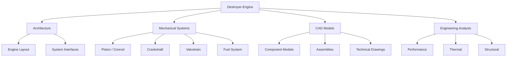
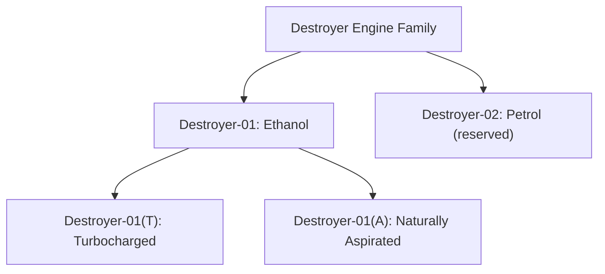
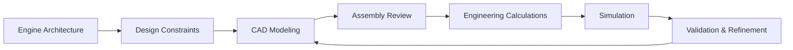
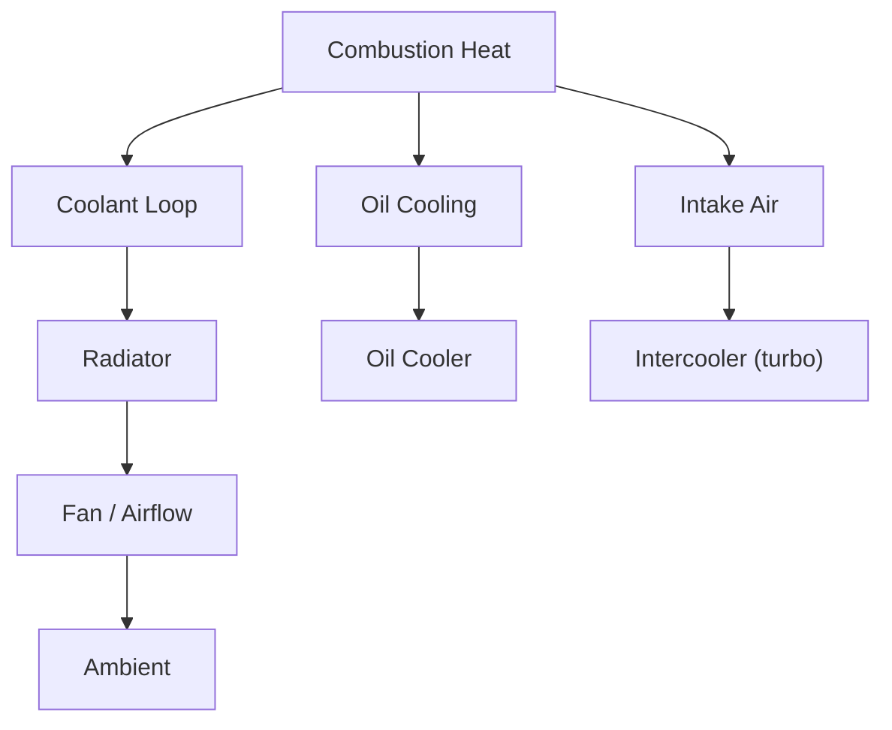
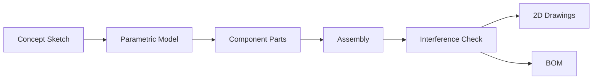

# Destroyer-Engine

**An independent engine design and engineering project.**

Destroyer-Engine is dedicated to the conceptual design, CAD modeling, and engineering analysis of an internal combustion engine. The project focuses on mechanical architecture, component systems, performance constraints, thermal management, and detailed 3D assemblies.

> Status: **conceptual development stage.** Specifications, CAD models, and performance targets are documented as they are established. Estimated, calculated, simulated, and experimentally measured results are always distinguished.

---

## Table of Contents

- [Engineering Overview](#engineering-overview)
- [Project Objectives](#project-objectives)
- [Engine Family](#engine-family)
- [Repository Structure](#repository-structure)
- [Development Workflow](#development-workflow)
- [Thermal Management](#thermal-management)
- [CAD Pipeline](#cad-pipeline)
- [Engineering Constraints (Destroyer-01 baseline)](#engineering-constraints-destroyer-01-baseline)
- [Materials & Components](#materials--components)
- [Calculations & Simulation](#calculations--simulation)
- [Software Stack](#software-stack)
- [Wiki Documentation](#wiki-documentation)
- [Development Status](#development-status)
- [Engineering Principles](#engineering-principles)
- [License](#license)

---

## Engineering Overview



<details>
<summary>Mermaid source</summary>



</details>

The engine is decomposed into four top-level domains — **Architecture**, **Mechanical Systems**, **CAD Models**, and **Engineering Analysis** — each with its own components and review gates.

---

## Project Objectives

- **Engine Architecture:** Establish the mechanical layout, component arrangement, and system interfaces.
- **CAD Development:** Create detailed 3D component models, assemblies, and technical drawings.
- **Performance Constraints:** Define and analyze power, torque, pressure, and operating limits.
- **Thermal Management:** Investigate cooling requirements, heat transfer, and temperature constraints.
- **Materials & Components:** Document material choices, component specifications, and design considerations.
- **Engineering Analysis:** Develop calculations and simulations to evaluate design decisions.

---

## Engine Family



<details>
<summary>Mermaid source</summary>



</details>

- **Destroyer-01** — ethanol-fueled internal combustion engine concept. Initial focus of the project.
  - **Destroyer-01(T)** — turbocharged variant (planned; feasibility TBD).
  - **Destroyer-01(A)** — naturally aspirated variant; current baseline.
- **Destroyer-02** — petrol-fueled concept, reserved for potential future development.

The turbocharged variant remains planned; its specification and feasibility are still to be evaluated.

The naturally aspirated Destroyer-01(A) baseline is now defined: 1998 cc inline-4, 86.0 × 86.0 mm bore/stroke, 12.5:1 compression ratio, 150 kW / 215 N·m design targets, 7500 rpm redline, and E100 port injection. See the [Destroyer-01 specification](Specifications/Destroyer-01-specification.md). These are conceptual targets, not validated results.

---

## Repository Structure

```text
Destroyer-Engine/
├── CAD/
│   ├── Components/
│   ├── Assemblies/
│   └── Drawings/
├── Architecture/
├── Mechanical-Systems/
├── Engineering-Constraints/
│   └── constraints.md
├── Materials/
├── Calculations/
│   ├── calculations.py
│   ├── analyse_spec.py
│   └── test_calculations.py
├── Simulation/
│   └── OpenFOAM/
├── Specifications/
│   ├── Destroyer-01-specification.md
│   └── destroyer-01.json
├── Software-Stack.md
├── compose.yaml
├── pixi.toml
├── diagrams/            # rendered figures (SVG)
├── LICENSE
└── README.md
```

The directory structure will evolve as the design develops.

---

## Development Workflow


<details>
<summary>Mermaid source</summary>



</details>

Each stage identifies design issues and guides subsequent revisions. Simulation results are **not** treated as experimental proof.

---

## Thermal Management


<details>
<summary>Mermaid source</summary>



</details>

Cooling paths are split by heat source: coolant loop → radiator → fan → ambient; oil → oil cooler; intake air → intercooler (turbo variant only). First-order heat-rejection targets and coolant/oil flow rates are recorded in the Destroyer-01 specification; they remain to be validated by thermal simulation and testing.

---

## CAD Pipeline


<details>
<summary>Mermaid source</summary>



</details>

All parts are modeled parametrically so dimensions can be driven by the engineering constraints. Assemblies undergo interference checks before drawings and BOM generation.

---

## Engineering Constraints (Destroyer-01 baseline)

Values below are **design targets** for Destroyer-01(A). They are not yet validated by simulation or testing. The full constraint register is in [`Engineering-Constraints/constraints.md`](Engineering-Constraints/constraints.md); the numeric baseline is in [`Specifications/destroyer-01.json`](Specifications/destroyer-01.json).

| Parameter | Target | Status |
|---|---|---|
| Fuel | Ethanol (E100), RON ≥ 108 | defined |
| Layout | Inline-4, DOHC 16-valve, NA | defined |
| Displacement | 1998 cc | design target |
| Bore × Stroke | 86.0 × 86.0 mm | design target |
| Compression ratio | 12.5:1 | design target |
| Max power | 150 kW @ 7000 rpm | design target |
| Max torque | 215 N·m @ 4800 rpm | design target |
| Redline | 7500 rpm | design target |
| Cooling | Liquid-cooled, 90 °C outlet target | defined |
| Aspiration | NA baseline; turbo variant planned | planned variant |

---

## Materials & Components

Material choices and component specifications are documented per part under `Materials/` and `Specifications/`. The preliminary Destroyer-01 baseline is:

- **Block / head:** A356-T6 aluminium (provisional), with pressed-in iron liners in the block.
- **Crankshaft / rods:** forged 4340 steel.
- **Pistons:** forged 2618-T61 aluminium.
- **Valves:** 21-4N intake, Inconel 751 exhaust (provisional).
- **Gaskets / seals:** MLS head gasket, FKM / PTFE ethanol-compatible seals.

See [`Materials/README.md`](Materials/README.md) for selection criteria and status.

---

## Calculations & Simulation

- Hand calculations and the Python toolkit live under `Calculations/`.
- FEA / thermal / CFD studies live under `Simulation/`.
- The controlled CAD/CAE toolchain is documented in [`Software-Stack.md`](Software-Stack.md).
- Every result must be tagged as **estimated / calculated / simulated / measured** and reference its assumptions.
- Run `python3 Calculations/analyse_spec.py` to check the baseline for internal consistency, and `python3 Calculations/test_calculations.py` to run the unit tests.

---

## Software Stack

The project uses an open-source, macOS-first toolchain that permits commercial use:

- **CAD:** FreeCAD 1.1 (Assembly, TechDraw, FEM), with optional CadQuery/build123d for code-generated parts.
- **Meshing / FEA:** Gmsh and CalculiX 2.23.
- **CFD:** OpenFOAM 2412 in a Linux container, with ParaView for post-processing.
- **1-D engine simulation:** Python + Cantera as the primary transparent model; OpenWAM as an independent cross-check.
- **Environment:** `pixi.toml` pins the analysis packages; `compose.yaml` runs OpenFOAM.

Installation, licensing, conventions, and rejected alternatives are in [`Software-Stack.md`](Software-Stack.md).

---

## Development Status

Destroyer-Engine is in the conceptual development stage. The Destroyer-01(A) baseline geometry, performance targets, and constraint register are established as design targets; the analysis toolchain is installed and verified, and documented in [`Software-Stack.md`](Software-Stack.md). Detailed CAD, 1-D simulation, structural FEA, and dyno validation are pending.

Estimated, calculated, simulated, and experimentally measured results are distinguished clearly. The current baseline is a set of targets, not a validated design.

---

## Engineering Principles

- Document assumptions and design constraints.
- Prioritize mechanical consistency and component compatibility.
- Evaluate performance alongside thermal, structural, and material limits.
- Keep design revisions and technical decisions traceable.
- Validate engineering claims against appropriate evidence.

---

## Wiki Documentation

Background and learning material lives on the **GitHub Wiki**:
- **Learning Base** — fundamentals, thermodynamics, calculations, materials, thermal, CAD, references.
- **Project Base** — project notes and design discussion.

The repository keeps the controlled specifications, constraints, calculations, CAD models, and code. The wiki is for supporting material, not the controlled baseline.

## License

See the [`LICENSE`](LICENSE) file for the applicable licensing terms.

---

*Conceptualize. Design. Analyze. Validate.*